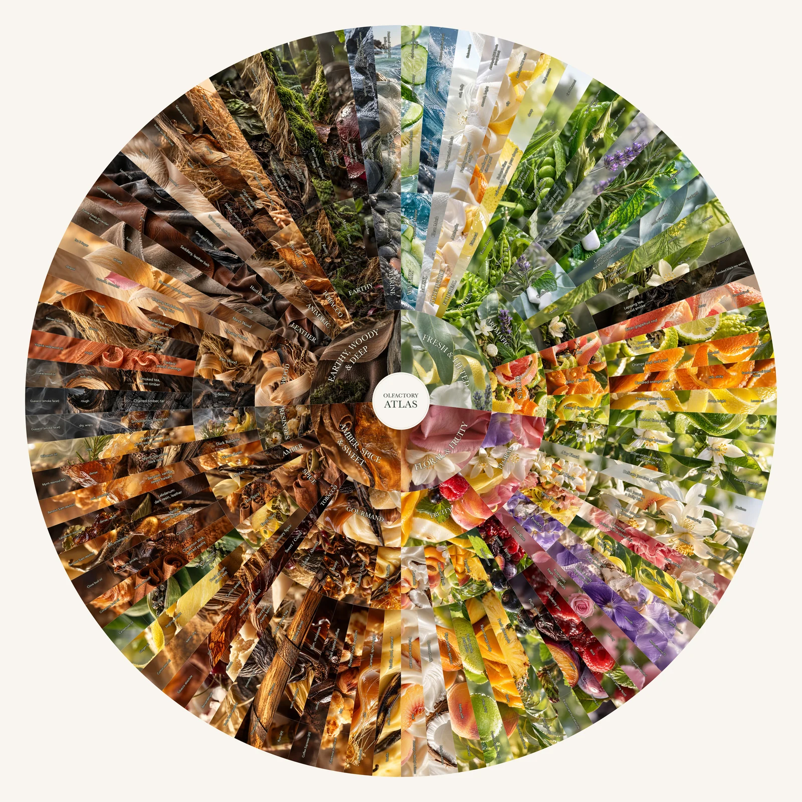

# Olfactory Atlas

A photographic vocabulary for describing scent: **20 families, 82 scent possibilities, 318 labels and 130 image compositions**. Follow a familiar impression toward more specific comparisons, feel words and study references.



## Explore

The exhibit is included in this folder. No install, API key, account or build step is needed. From this folder, run:

```sh
python3 -m http.server 8000 --bind 127.0.0.1
```

Open **http://127.0.0.1:8000/**. The [full exploration tool](exhibit/index.html) lets you drag to pan, scroll/pinch to zoom, select a family or click a scent sector. The question panel offers choices from broad impressions to specific comparisons, with route highlighting, Back, breadcrumbs and Start again. It is open exploration, without a scripted tour. On phones the wheel stays above a separately scrolling question panel; landscape uses a side panel. **Wheel only** gives the illustration the screen, and **Show questions** restores the same scent path. **Tools** contains the extra view controls. **Reading size** shows native detail; **Fit selection** returns to the chosen scent; **Whole wheel** zooms out. Hide words reveals the photography. With the wheel focused, use arrows, +/−, 0 (whole wheel) and 1 (reading size).

[Read the article on ryannel.dev](https://ryannel.dev/projects/olfactory-atlas/) for the story, the design choices and how to use the wheel. This repository is the home of the finished product and its reproducible source.

The viewer uses local WebP tiles and works without internet after cloning. It needs HTTP rather than a `file://` URL. The standalone image below opens without a server.

To clone only this experiment from the collection:

```sh
git clone --depth 1 --filter=blob:none --sparse https://github.com/ryannel/experiments.git
cd experiments
git sparse-checkout set olfactory_taxonomy
cd olfactory_taxonomy
python3 -m http.server 8000 --bind 127.0.0.1
```

## Image and originals

| Edition | Purpose | Location |
| --- | --- | --- |
| Full-size AVIF, 9,216 × 9,216, about 5.5 MB | A single shareable image; modern browsers and image viewers | [Download image](exports/olfactory-atlas.avif) |
| Tiled exhibit, with and without labels | Smooth exploration without decoding the whole master for every interaction | `exhibit/` |
| Original PNG photographs and editable SVG | Continue designing at original source quality | [Working-source archive](https://github.com/ryannel/experiments/releases/download/olfactory-atlas-v1/olfactory-atlas-working-source.zip) |
| Full-resolution approved PNG, about 121 MB | Lossless copy of the approved flattened screen render | [Download PNG](https://github.com/ryannel/experiments/releases/download/olfactory-atlas-v1/olfactory-atlas-approved.png) |

The compact image is lossy; it **does not replace the originals**. All 130 selected original PNGs are retained byte-for-byte in the working-source archive, with SHA-256 checksums. The editable master, artwork manifest and exact generation prompts are also checked into `source/`. Run `python3 scripts/restore_sources.py` to download and verify the archive and install only missing original images. This preserves any SVG, prompt or metadata edits you have made. Use `--archive /path/to/olfactory-atlas-working-source.zip` for a local download. The PNG screen render preserves the approved raster; the authoring SVG points to the higher-quality original photographs rather than the earlier compressed delivery copies.

The AVIF was selected after comparing it with an 11.8 MB WebP at the same dimensions. It retains readable lettering and photographic detail in reviewed crops at less than half that size. Zooming beyond native size does not create additional image detail.

## What is in the folder?

- `index.html` — introduction to the project.
- `exhibit/` — ready-to-use viewer, local tiles and overview image.
- `exports/` — the compact complete wheel.
- `source/` — approved editable SVG, selected-asset manifest, original prompts, fresh-generation briefs and fit records.
- `data/` — source taxonomy, current cells, editorial references and style settings.
- `scripts/`, `templates/` — the data-derived exploration tool, validation and supported export workflow.
- `skills/olfactory-sunburst/` — the current assembly and imagery guidance.
- `docs/EDITING.md` — how to restore sources, make changes and rebuild the exhibit.

The project contains the final product and its reusable authoring specification. It has no historical artwork or prototype archive dependency. It does not depend on any sibling experiment or machine-specific path.

## Start from scratch

The [project skill](skills/olfactory-sunburst/SKILL.md) and its [from-scratch recipe](skills/olfactory-sunburst/references/from-scratch.md) cover content, geometry, scent-specific imagery, assembly, typography and export. To plan a fresh set of images from the final specification:

```sh
python3 scripts/plan_artwork.py
```

This writes `build/artwork-plan.json`: 130 self-contained generation briefs covering all 318 cells, ordered from outer routes to broad-area summaries, with exact sector clips and scent context. It requires no original images or discarded drafts. Six original prompts were edits; fresh standalone replacements are included so those jobs also work without earlier inputs. New images use the built-in image-generation tool and will vary from the accepted originals.

## Continue working

See [the editing guide](docs/EDITING.md) for label, image, crop, geometry and interface changes.

`source/master.svg` is the accepted assembly: photographs, exact geometry, boundaries and editable text are separate layers. Install the working-source archive before opening it. Baskerville and Avenir are referenced, not bundled; use those fonts for matching exports. Substituting fonts requires a fresh layout check. Edit the master directly and keep `data/cells.json` and `source/artwork.json` consistent with deliberate content or image changes.

Viewing needs only Python's standard-library HTTP server. Re-encoding the exhibit needs Node.js 20.9+ and the pinned Sharp development dependency:

```sh
npm ci
npm run prepare:render
python3 -m http.server 8000 --bind 127.0.0.1
```

Open `http://127.0.0.1:8000/build/render.html`. Export both browser-rendered PNGs and save them as `build/labels.png` and `build/image.png`. Then:

```sh
npm run build:tiles
npm run verify
```

Preparation embeds the original PNGs without recompression. It can use substantial memory; the checked-in tiled exhibit avoids this work for visitors. `npm run build` rebuilds the viewer from its templates and this repo’s final data; it does not re-encode photographs. The question hierarchy is generated by `scripts/exploration-data.cjs` from `data/cells.json` and the final editorial choices, rather than copied from the article site. For structural checks without Node or originals:

```sh
python3 scripts/build_layout.py
python3 scripts/validate_exhibit.py
```

Add `--originals` to the second command to verify every installed original against its checksum.

## Context

This is a personal, selectively structured scent guide, developed through iterative design and review with AI assistance. The imagery is AI-generated. Materials illustrate scent facets; they are not ingredients identified by smelling a perfume. Suggested textures are optional associations. The wheel does not measure longevity or claim exhaustive, professional sensory validation.

See [PROVENANCE.md](PROVENANCE.md) for the source data, editorial work and image provenance. This release is a screen exhibit, not a verified print-production master.
